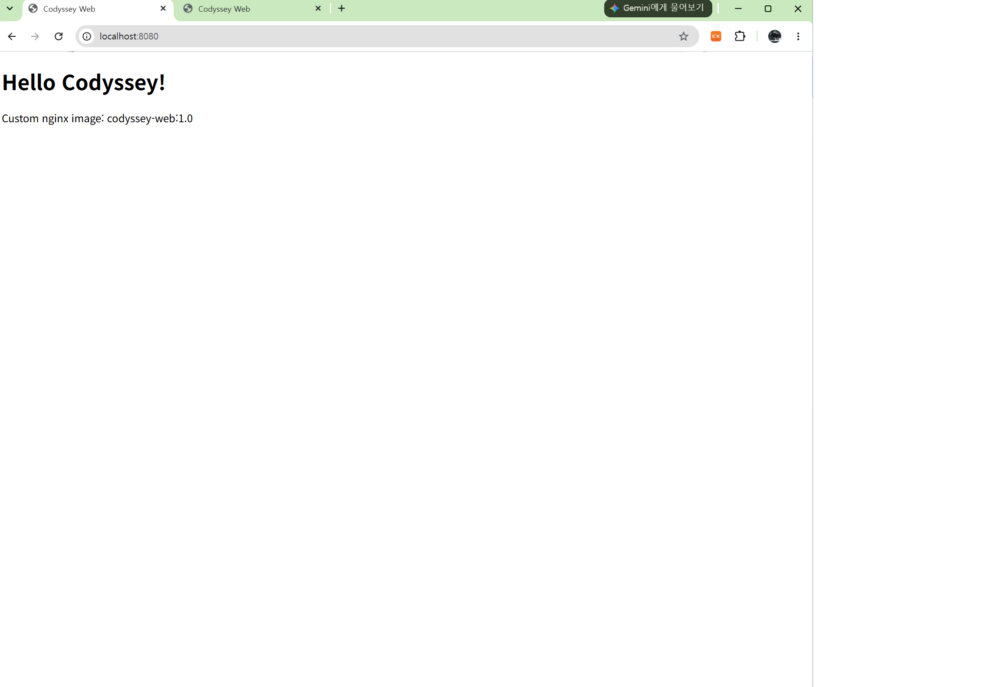
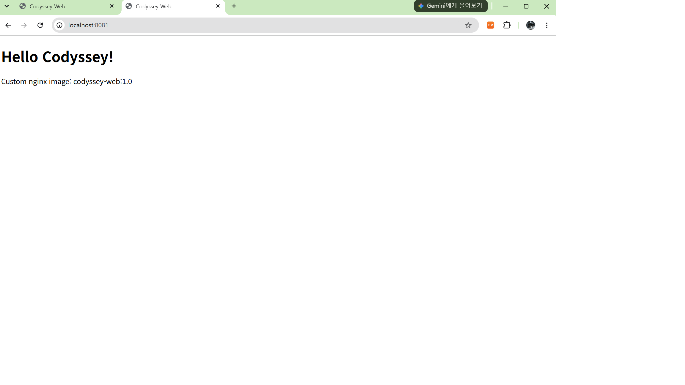
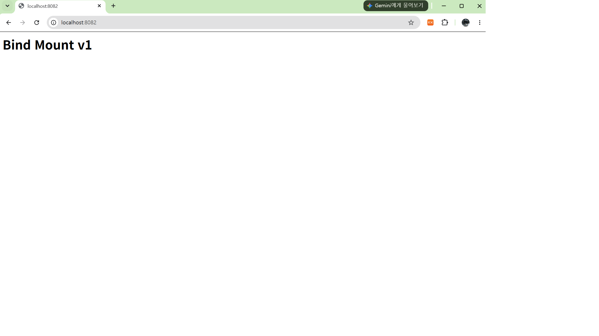
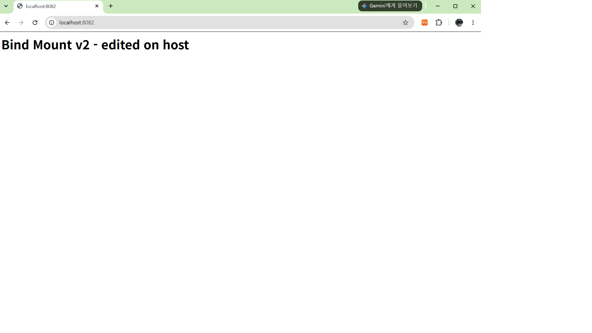
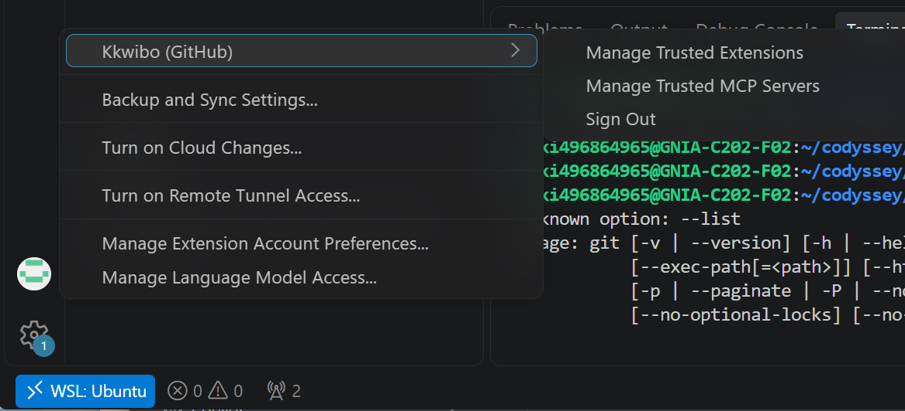

# 개발 워크스테이션 구축 (Codyssey 입학연수)

> 터미널 · 권한 · Docker · Dockerfile · 포트 매핑 · 바인드 마운트 · 볼륨 · Git/GitHub를 직접 세팅하고,
> **실행 결과(로그 / 접속 화면 / 데이터 유지)** 로 각 동작을 검증한 기록입니다.

## 목차

1. [프로젝트 개요](#overview)
2. [실행 환경](#env)
3. [수행 체크리스트](#checklist)
4. [저장소 구조](#structure)
5. [검증 방법 요약 (명령 → 확인 내용 → 증거 위치)](#verify)
6. [터미널 조작 로그](#log-terminal)
7. [권한 실습](#log-permission)
8. [Docker 설치 및 점검](#log-docker-check)
9. [컨테이너 실행 실습 (hello-world / ubuntu / exec vs attach)](#log-container)
10. [Docker 운영 명령 (logs / stats)](#log-ops)
11. [Dockerfile 커스텀 이미지](#log-dockerfile)
12. [포트 매핑 접속](#log-port)
13. [바인드 마운트](#log-bind)
14. [Docker 볼륨 영속성](#log-volume)
15. [Git 설정 및 GitHub / VSCode 연동](#log-git)
16. [개념 정리](#concepts)
17. [트러블슈팅](#troubleshooting)
18. [보안 및 개인정보 점검](#security)
19. [재현 시 주의사항](#reproduce)

---

<a id="overview"></a>
## 1. 프로젝트 개요

- **목표**: "내 컴퓨터에서만 되는" 환경이 아니라, 누구나 같은 절차로 실행·검증할 수 있는 개발 워크스테이션을 구성한다.
- **핵심 도구**: Linux CLI(WSL2 Ubuntu) · Docker(Docker Desktop) · Git / GitHub · VSCode
- **수행 내용**
  - 터미널로 작업 디렉토리 생성·이동·복사·삭제, 파일/디렉토리 권한 변경 실험
  - Docker 설치 점검, 이미지·컨테이너 운영 명령 실습
  - `nginx:alpine` 기반 커스텀 이미지 제작 → 포트 매핑으로 브라우저 접속
  - 바인드 마운트로 "호스트 변경 즉시 반영", 볼륨으로 "컨테이너 삭제 후에도 데이터 유지" 검증
  - Git 설정, VSCode GitHub 로그인, 원격 저장소 연동 및 push

---

<a id="env"></a>
## 2. 실행 환경

| 항목 | 값 |
|---|---|
| Host OS | Windows + WSL2 |
| Linux 배포판 | Ubuntu 26.04.1 LTS (WSL2) |
| Shell / Terminal | bash (`/bin/bash`) / Ubuntu 터미널, VSCode 통합 터미널(WSL) |
| Docker | Docker Desktop 4.98.0, Docker Engine 29.9.2 (WSL 2 backend) |
| Git | 2.53.0 |
| Editor | Visual Studio Code + WSL 확장 |
| 작업 경로 | `~/codyssey/workstation` (WSL 리눅스 홈) |

```bash
$ cat /etc/os-release | head -2
PRETTY_NAME="Ubuntu 26.04.1 LTS"
NAME="Ubuntu"
$ echo $SHELL
/bin/bash
$ git --version
git version 2.53.0
$ docker --version
Docker version 29.9.2, build a82e528
```

---

<a id="checklist"></a>
## 3. 수행 체크리스트

- [x] 터미널 기본 조작 (pwd, ls -la, cd, mkdir, cp, mv, rm, cat, touch)
- [x] 권한 변경 실습 (파일 1개, 디렉토리 1개 / 변경 전·후 비교)
- [x] Docker 설치 및 점검 (`docker --version`, `docker info`)
- [x] `hello-world` 실행
- [x] `ubuntu` 컨테이너 진입 후 명령 실행, exec vs attach 차이 관찰
- [x] Docker 운영 명령 (`images`, `ps`, `ps -a`, `logs`, `stats`, `stop`)
- [x] Dockerfile 작성 → 커스텀 이미지 빌드 및 실행
- [x] 포트 매핑 접속 (8080, 8081 — 같은 이미지로 2개 컨테이너)
- [x] 바인드 마운트 반영 확인 (호스트 수정 → 즉시 반영)
- [x] 볼륨 영속성 확인 (컨테이너 삭제 후 재연결 → 데이터 유지)
- [x] Git 사용자 정보 / 기본 브랜치 설정
- [x] VSCode GitHub 로그인 및 저장소 연동, push

---

<a id="structure"></a>
## 4. 저장소 구조

```
workstation/
├── README.md               # 기술 문서 (이 파일)
├── app/
│   ├── Dockerfile          # nginx:alpine 기반 커스텀 이미지
│   ├── site/index.html     # 이미지에 COPY 되는 정적 페이지
│   └── bind-site/index.html# 바인드 마운트 실습용 (호스트에서 수정)
├── practice/               # 터미널 / 권한 실습 결과물
│   ├── empty.txt
│   ├── memo.txt
│   ├── hello.sh            # 권한 실습 (644 → 755)
│   └── perm_dir/           # 권한 실습 (755 → 700 → 644 → 755)
└── docs/images/            # 증거 스크린샷
```

---

<a id="verify"></a>
## 5. 검증 방법 요약

| 항목 | 실행 명령 | 확인한 것 | 증거 |
|---|---|---|---|
| 터미널 조작 | `pwd`, `ls -la`, `mkdir`, `cp`, `mv`, `rm` … | 생성·복사·이동·삭제 결과가 `ls -la`에 반영 | [로그](#log-terminal) |
| 파일 권한 | `chmod 755 hello.sh` | 644에선 `Permission denied`, 755에선 실행 성공 | [로그](#log-permission) |
| 디렉토리 권한 | `chmod 700/644/755 perm_dir` | x 권한이 없으면 `cd` 불가 | [로그](#log-permission) |
| Docker 점검 | `docker --version`, `docker info` | Client/Server 버전 출력 = 데몬 동작 | [로그](#log-docker-check) |
| 컨테이너 실행 | `docker run hello-world`, `docker run -it ubuntu bash` | Hello 메시지, 컨테이너 내부 명령 실행 | [로그](#log-container) |
| exec vs attach | `docker exec -it`, `docker attach` | exec 종료 후 `Up` 유지 / attach 종료 후 `Exited` | [로그](#log-container) |
| 운영 명령 | `docker logs`, `docker stats --no-stream` | 로그 출력, CPU/MEM 사용량 | [로그](#log-ops) |
| 커스텀 이미지 | `docker build -t codyssey-web:1.0 .` | 빌드 성공, ENV/LABEL/HEALTHCHECK 적용 | [로그](#log-dockerfile) |
| 포트 매핑 | `docker run -p 8080:80`, `-p 8081:80` + `curl` | 두 포트 모두 200 응답, 브라우저 접속 | [로그·스크린샷](#log-port) |
| 바인드 마운트 | `-v "$(pwd)/bind-site":/usr/share/nginx/html` | 호스트 수정이 재빌드 없이 반영 | [로그·스크린샷](#log-bind) |
| 볼륨 영속성 | `docker volume create`, `rm -f` 후 재연결 | 새 컨테이너에서도 `persist me` 유지 | [로그](#log-volume) |
| Git / GitHub | `git config --list`, `git remote -v`, `git push` | 사용자 정보·브랜치 설정, 원격 연동 | [로그·스크린샷](#log-git) |

---

<a id="log-terminal"></a>
## 6. 터미널 조작 로그

```bash
# 현재 위치 확인
$ pwd
/home/tiki496864965

# 작업 디렉토리 생성 후 이동 (-p: 중간 경로가 없으면 함께 생성)
$ mkdir -p ~/codyssey/workstation
$ cd ~/codyssey/workstation
$ pwd
/home/tiki496864965/codyssey/workstation

# 숨김 파일 포함 목록 확인
$ ls -la
total 8
drwxr-xr-x 2 tiki496864965 tiki496864965 4096 Nov  5 17:37 .
drwxr-xr-x 3 tiki496864965 tiki496864965 4096 Nov  5 17:37 ..

# 디렉토리 생성 / 이동 (상대 경로)
$ mkdir practice
$ cd practice

# 빈 파일 생성 / 내용 있는 파일 생성 / 내용 확인
$ touch empty.txt
$ echo "hello codyssey" > memo.txt
$ cat memo.txt
hello codyssey

# 복사 → 이름 변경 → 다른 디렉토리로 이동
$ cp memo.txt memo_copy.txt
$ mv memo_copy.txt renamed.txt
$ mkdir backup
$ mv renamed.txt backup/
$ ls -la
total 16
drwxr-xr-x 3 tiki496864965 tiki496864965 4096 Nov  5 17:39 .
drwxr-xr-x 3 tiki496864965 tiki496864965 4096 Nov  5 17:38 ..
drwxr-xr-x 2 tiki496864965 tiki496864965 4096 Nov  5 17:39 backup
-rw-r--r-- 1 tiki496864965 tiki496864965    0 Nov  5 17:38 empty.txt
-rw-r--r-- 1 tiki496864965 tiki496864965   15 Nov  5 17:38 memo.txt
$ ls -la backup
total 12
drwxr-xr-x 2 tiki496864965 tiki496864965 4096 Nov  5 17:39 .
drwxr-xr-x 3 tiki496864965 tiki496864965 4096 Nov  5 17:39 ..
-rw-r--r-- 1 tiki496864965 tiki496864965   15 Nov  5 17:39 renamed.txt

# 삭제 (파일 → 빈 디렉토리)
$ rm backup/renamed.txt
$ rmdir backup
$ ls -la
total 12
drwxr-xr-x 2 tiki496864965 tiki496864965 4096 Nov  5 17:40 .
drwxr-xr-x 3 tiki496864965 tiki496864965 4096 Nov  5 17:38 ..
-rw-r--r-- 1 tiki496864965 tiki496864965    0 Nov  5 17:38 empty.txt
-rw-r--r-- 1 tiki496864965 tiki496864965   15 Nov  5 17:38 memo.txt

# 상대 경로(..) vs 절대 경로(~/...)
$ cd ..
$ pwd
/home/tiki496864965/codyssey/workstation
$ cd ~/codyssey/workstation/practice
$ pwd
/home/tiki496864965/codyssey/workstation/practice
```

---

<a id="log-permission"></a>
## 7. 권한 실습

### 7-1. 파일 권한 — `hello.sh` (644 → 755)

```bash
$ echo 'echo "permission test OK"' > hello.sh
$ ls -l hello.sh
-rw-r--r-- 1 tiki496864965 tiki496864965 26 Nov  5 17:43 hello.sh     # 변경 전 644
$ ./hello.sh
-bash: ./hello.sh: Permission denied                                    # x 권한 없음

$ chmod 755 hello.sh
$ ls -l hello.sh
-rwxr-xr-x 1 tiki496864965 tiki496864965 26 Nov  5 17:43 hello.sh     # 변경 후 755
$ ./hello.sh
permission test OK                                                      # 실행 성공
```

### 7-2. 디렉토리 권한 — `perm_dir` (755 → 700 → 644 → 755)

```bash
$ mkdir perm_dir
$ touch perm_dir/inside.txt
$ ls -ld perm_dir
drwxr-xr-x 2 tiki496864965 tiki496864965 4096 Nov  5 17:47 perm_dir   # 755 (기본)

$ chmod 700 perm_dir
$ ls -ld perm_dir
drwx------ 2 tiki496864965 tiki496864965 4096 Nov  5 17:47 perm_dir   # 700: 소유자만 접근

$ chmod 644 perm_dir
$ ls -ld perm_dir
drw-r--r-- 2 tiki496864965 tiki496864965 4096 Nov  5 17:47 perm_dir   # 644: x 제거
$ cd perm_dir
-bash: cd: perm_dir: Permission denied                                  # x 없으면 진입 불가
$ ls -l perm_dir
total 0
-????????? ? ? ? ?            ? inside.txt                             # r은 있어 이름만 보이고 상세정보는 못 읽음

$ chmod 755 perm_dir
$ ls -ld perm_dir
drwxr-xr-x 2 tiki496864965 tiki496864965 4096 Nov  5 17:47 perm_dir   # 원복
$ cd perm_dir
$ pwd
/home/tiki496864965/codyssey/workstation/practice/perm_dir
```

**관찰**: 파일의 `x`는 "실행", 디렉토리의 `x`는 "안으로 들어가기(경로 탐색)"이다. 디렉토리에 파일용 권한(644)을 주면 쓸 수 없게 된다.

---

<a id="log-docker-check"></a>
## 8. Docker 설치 및 점검

Windows에 Docker Desktop을 설치하고 **Settings → Resources → WSL integration**에서 Ubuntu를 활성화하여, WSL 터미널에서 `docker` 명령을 사용했다.

```bash
$ docker --version
Docker version 29.9.2, build a82e528

$ docker info        # (발췌)
Client:
 Version:    29.9.2
 Context:    default
 ...
Server:
 Containers: 0
  Running: 0
  Paused: 0
  Stopped: 0
 Images: 0
 Server Version: 29.9.2
 Storage Driver: overlayfs
 Cgroup Version: 2
 Kernel Version: 6.18.54.1-microsoft-standard-WSL2
 Operating System: Docker Desktop
 OSType: linux
 Architecture: x86_64
 CPUs: 24
 Total Memory: 15.25GiB
```

**판단 근거**: `Server:` 섹션이 정상 출력되었으므로 Docker 데몬이 동작 중이다. (데몬이 꺼져 있으면 `Cannot connect to the Docker daemon` 에러가 출력된다.)

---

<a id="log-container"></a>
## 9. 컨테이너 실행 실습

### 9-1. hello-world

```bash
$ docker run hello-world
Unable to find image 'hello-world:latest' locally
latest: Pulling from library/hello-world
4f55086f7dd0: Pull complete
Digest: sha256:c567b231f65614688711a75f31518a064258a51d442117a3e771a3a8fdba78ef
Status: Downloaded newer image for hello-world:latest

Hello from Docker!
This message shows that your installation appears to be working correctly.
...

$ docker images
IMAGE                ID             DISK USAGE   CONTENT SIZE   EXTRA
hello-world:latest   c567b231f656       25.9kB         9.49kB    U

$ docker ps -a
CONTAINER ID   IMAGE         COMMAND    CREATED              STATUS                          PORTS     NAMES
32d047bc319d   hello-world   "/hello"   About a minute ago   Exited (0) About a minute ago             magical_wozniak
```

- 로컬에 이미지가 없어서 Docker Hub에서 자동으로 pull 후 실행했다.
- 메시지를 출력하고 프로세스가 끝나서 `Exited (0)`(정상 종료) 상태가 된다. `docker ps`는 실행 중인 컨테이너만, `docker ps -a`는 종료된 것까지 보여준다.

### 9-2. ubuntu 컨테이너 진입

```bash
$ docker pull ubuntu
Using default tag: latest
latest: Pulling from library/ubuntu
Status: Downloaded newer image for ubuntu:latest
docker.io/library/ubuntu:latest

$ docker run -it --name my-ubuntu ubuntu bash
root@7bfb8dca090e:/# ls
bin  boot  dev  etc  home  lib  lib64  media  mnt  opt  proc  root  run  sbin  srv  sys  tmp  usr  var
root@7bfb8dca090e:/# cat /etc/os-release | head -2
PRETTY_NAME="Ubuntu 26.04.1 LTS"
NAME="Ubuntu"
root@7bfb8dca090e:/# exit

$ docker ps -a
CONTAINER ID   IMAGE         COMMAND    CREATED          STATUS                     PORTS     NAMES
7bfb8dca090e   ubuntu        "bash"     58 seconds ago   Exited (0) 5 seconds ago             my-ubuntu
```

- 프롬프트가 `root@<컨테이너ID>`로 바뀌고, 호스트의 파일(`~/codyssey` 등)은 보이지 않는다 → 격리된 파일 시스템.
- 메인 프로세스인 `bash`를 `exit`로 끝내자 컨테이너도 함께 종료되었다.

### 9-3. exec vs attach

```bash
$ docker start my-ubuntu
$ docker ps
CONTAINER ID   IMAGE     COMMAND   CREATED         STATUS         PORTS     NAMES
7bfb8dca090e   ubuntu    "bash"    2 minutes ago   Up 4 seconds             my-ubuntu

# ① exec: 새 bash 프로세스를 추가로 실행
$ docker exec -it my-ubuntu bash
root@7bfb8dca090e:/# echo "hello from container (exec)"
hello from container (exec)
root@7bfb8dca090e:/# exit
$ docker ps
CONTAINER ID   IMAGE     COMMAND   CREATED         STATUS          PORTS     NAMES
7bfb8dca090e   ubuntu    "bash"    3 minutes ago   Up 44 seconds             my-ubuntu    # 컨테이너 유지

# ② attach: 메인 프로세스(PID 1 bash)에 직접 연결
$ docker start my-ubuntu
$ docker attach my-ubuntu
root@7bfb8dca090e:/# echo "hello from container (attach)"
hello from container (attach)
root@7bfb8dca090e:/# exit
$ docker ps -a
CONTAINER ID   IMAGE         COMMAND    CREATED          STATUS                     PORTS     NAMES
7bfb8dca090e   ubuntu        "bash"     6 minutes ago    Exited (0) 5 seconds ago             my-ubuntu   # 컨테이너 종료
```

| | `docker exec -it <이름> bash` | `docker attach <이름>` |
|---|---|---|
| 동작 | 컨테이너 안에 **새 프로세스**를 띄움 | 이미 실행 중인 **메인 프로세스**의 입출력에 연결 |
| `exit` 시 | 새로 띄운 bash만 종료 → 컨테이너 **유지(Up)** | 메인 프로세스 종료 → 컨테이너 **종료(Exited)** |
| 종료 없이 빠져나오기 | `exit` | `Ctrl+P` → `Ctrl+Q` |
| 주 용도 | 실행 중인 서버 점검·디버깅 | 메인 프로세스의 출력을 직접 볼 때 |

---

<a id="log-ops"></a>
## 10. Docker 운영 명령 (logs / stats)

```bash
# 2초마다 시간을 출력하는 컨테이너를 백그라운드(-d)로 실행
$ docker run -d --name log-test ubuntu bash -c 'while true; do echo "tick $(date)"; sleep 2; done'
ed9d5cf1b07f8b1e7aa0519d5b60d0b4b5e485e6b9a5bc28f9ecf044fd1c14fe

$ docker ps
CONTAINER ID   IMAGE     COMMAND                  CREATED         STATUS         PORTS     NAMES
ed9d5cf1b07f   ubuntu    "bash -c 'while true…"   8 seconds ago   Up 7 seconds             log-test

$ docker logs log-test
tick Thu Nov  5 10:13:13 UTC 2026
tick Thu Nov  5 10:13:15 UTC 2026
tick Thu Nov  5 10:13:17 UTC 2026
...
tick Thu Nov  5 10:13:31 UTC 2026

$ docker stats --no-stream
CONTAINER ID   NAME       CPU %     MEM USAGE / LIMIT     MEM %     NET I/O         BLOCK I/O     PIDS
ed9d5cf1b07f   log-test   0.00%     14.02MiB / 15.25GiB   0.09%     1.17kB / 126B   20.6MB / 0B   2

$ docker stop log-test
log-test
$ docker ps -a
CONTAINER ID   IMAGE         COMMAND                  CREATED             STATUS                         PORTS     NAMES
ed9d5cf1b07f   ubuntu        "bash -c 'while true…"   46 seconds ago      Exited (137) 3 seconds ago               log-test
7bfb8dca090e   ubuntu        "bash"                   About an hour ago   Exited (0) About an hour ago             my-ubuntu
32d047bc319d   hello-world   "/hello"                 About an hour ago   Exited (0) About an hour ago             magical_wozniak
```

- 로그 시간이 UTC로 찍힌다: 컨테이너는 호스트의 시간대(KST)를 물려받지 않는다.
- `Exited (137)`의 의미는 [트러블슈팅 2](#ts-137) 참고.

---

<a id="log-dockerfile"></a>
## 11. Dockerfile 커스텀 이미지

### 11-1. 선택한 베이스와 방식

- **방식 (A)**: 웹 서버 베이스 이미지 활용 + 정적 콘텐츠/설정 교체
- **베이스 이미지**: 공식 `nginx:alpine` (Alpine Linux 기반 경량 nginx)

### 11-2. Dockerfile ([`app/Dockerfile`](app/Dockerfile))

```dockerfile
# 1) 베이스 이미지: 공식 nginx (alpine = 경량 리눅스)
FROM nginx:alpine

# 2) 이미지 정보(메타데이터)
LABEL org.opencontainers.image.title="codyssey-web"
LABEL org.opencontainers.image.description="Codyssey workstation custom nginx"

# 3) 환경 변수
ENV APP_ENV=dev

# 4) 내 정적 페이지로 교체
COPY site/ /usr/share/nginx/html/

# 5) 컨테이너가 사용하는 포트 문서화
EXPOSE 80

# 6) 헬스체크: 웹 서버가 응답하는지 주기적으로 확인
HEALTHCHECK --interval=30s --timeout=3s CMD wget -qO- http://localhost/ > /dev/null || exit 1
```

### 11-3. 커스텀 포인트와 목적

| 커스텀 포인트 | 목적 | 적용 확인 |
|---|---|---|
| `FROM nginx:alpine` | 웹 서버를 직접 설치하지 않고 검증된 공식 이미지 재사용, 경량화 | 이미지 크기 93.6MB (ubuntu 163MB보다 작음) |
| `LABEL` | 이미지 이름·설명 메타데이터로 관리 용이성 확보 | `docker inspect` 결과에 표시 |
| `ENV APP_ENV=dev` | 실행 환경(dev/prod)을 코드 밖에서 구분 | `printenv APP_ENV` → `dev` |
| `COPY site/ …` | nginx 기본 페이지를 **내 페이지로 교체** (핵심) | curl / 브라우저에 "Hello Codyssey!" |
| `EXPOSE 80` | 컨테이너가 사용하는 포트를 문서화 (실제 공개는 `-p`로) | `docker ps`의 `80/tcp` |
| `HEALTHCHECK` | "프로세스는 살아 있지만 응답 없음" 상태 감지 | `docker ps` STATUS `(healthy)` |

### 11-4. 빌드

```bash
$ cd ~/codyssey/workstation/app
$ docker build -t codyssey-web:1.0 .
[+] Building 5.6s (7/7) FINISHED                                         docker:default
 => [internal] load build definition from Dockerfile                               0.0s
 => [internal] load metadata for docker.io/library/nginx:alpine                    2.5s
 => [internal] load .dockerignore                                                  0.0s
 => [internal] load build context                                                  0.0s
 => [1/2] FROM docker.io/library/nginx:alpine@sha256:785835ea65db...               2.2s
 => [2/2] COPY site/ /usr/share/nginx/html/                                        0.1s
 => exporting to image                                                             0.6s
 => => naming to docker.io/library/codyssey-web:1.0                                0.0s

$ docker images
IMAGE                ID             DISK USAGE   CONTENT SIZE   EXTRA
codyssey-web:1.0     ba89dc01cb1b       93.6MB         26.3MB
hello-world:latest   c567b231f656       25.9kB         9.49kB    U
ubuntu:latest        6a06111c3b0a        163MB         45.9MB    U
```

- 파일 시스템을 바꾸는 `FROM`, `COPY`만 레이어(1/2, 2/2)로 표시되고, `LABEL`/`ENV`/`EXPOSE`/`HEALTHCHECK`는 이미지 설정(메타데이터)으로 저장된다.

### 11-5. 커스텀 포인트 적용 확인

```bash
$ docker exec web-8080 printenv APP_ENV
dev

$ docker inspect --format '{{json .Config.Labels}}' codyssey-web:1.0
{"maintainer":"NGINX Docker Maintainers <docker-maint@nginx.com>","org.opencontainers.image.description":"Codyssey workstation custom nginx","org.opencontainers.image.title":"codyssey-web"}
```

(`maintainer`는 베이스 이미지에서 상속된 라벨이다.)

---

<a id="log-port"></a>
## 12. 포트 매핑 접속

같은 이미지로 호스트 포트만 다르게 하여 컨테이너 2개를 실행했다.

```bash
$ docker run -d -p 8080:80 --name web-8080 codyssey-web:1.0
611b0cf6c676c962549603eda4bf3d76a18fac0ffe03938349870f8df9c12f15
$ docker run -d -p 8081:80 --name web-8081 codyssey-web:1.0
9f80d16081e7abfd93e56524fa917035f78e3b8fd184773dc389257f18723a24

$ docker ps
CONTAINER ID   IMAGE              COMMAND                  CREATED         STATUS                   PORTS                                     NAMES
9f80d16081e7   codyssey-web:1.0   "/docker-entrypoint.…"   2 minutes ago   Up 2 minutes (healthy)   0.0.0.0:8081->80/tcp, [::]:8081->80/tcp   web-8081
611b0cf6c676   codyssey-web:1.0   "/docker-entrypoint.…"   4 minutes ago   Up 4 minutes (healthy)   0.0.0.0:8080->80/tcp, [::]:8080->80/tcp   web-8080

$ curl http://localhost:8080
<!DOCTYPE html>
<html lang="ko">
<head>
  <meta charset="UTF-8">
  <title>Codyssey Web</title>
</head>
<body>
  <h1>Hello Codyssey!</h1>
  <p>Custom nginx image: codyssey-web:1.0</p>
</body>
</html>

$ curl http://localhost:8081
(위와 동일한 응답)

$ docker logs web-8080        # (발췌)
/docker-entrypoint.sh: Configuration complete; ready for start up
2026/11/05 10:25:54 [notice] 1#1: nginx/1.31.8
::1 - - [05/Nov/2026:10:26:24 +0000] "GET / HTTP/1.1" 200 199 "-" "Wget" "-"
172.17.0.1 - - [05/Nov/2026:10:28:43 +0000] "GET / HTTP/1.1" 200 199 "-" "curl/8.18.0" "-"
::1 - - [05/Nov/2026:10:28:54 +0000] "GET / HTTP/1.1" 200 199 "-" "Wget" "-"
```

- `::1` + `Wget`(30초 간격): 컨테이너 내부에서 실행된 **HEALTHCHECK** 요청
- `172.17.0.1` + `curl`: 호스트에서 **포트 매핑(8080→80)을 거쳐 들어온** 요청 (`172.17.0.1` = Docker bridge 게이트웨이)

**브라우저 접속 화면 (주소창 포함)**

| `http://localhost:8080` | `http://localhost:8081` |
|---|---|
|  |  |

---

<a id="log-bind"></a>
## 13. 바인드 마운트

호스트 디렉토리 `app/bind-site`를 컨테이너의 nginx 문서 루트에 연결하고, **호스트에서만** 파일을 수정했다.

```bash
$ cd ~/codyssey/workstation/app
$ mkdir -p bind-site
$ echo '<h1>Bind Mount v1</h1>' > bind-site/index.html
$ cat bind-site/index.html
<h1>Bind Mount v1</h1>

$ docker run -d -p 8082:80 --name web-bind -v "$(pwd)/bind-site":/usr/share/nginx/html codyssey-web:1.0
c21011506e87fdfcf059c508d641d1e1dda3340d35770503d11605faea2fdf30
$ docker ps
CONTAINER ID   IMAGE              COMMAND                  CREATED          STATUS                            PORTS                                     NAMES
c21011506e87   codyssey-web:1.0   "/docker-entrypoint.…"   8 seconds ago    Up 7 seconds (health: starting)   0.0.0.0:8082->80/tcp, [::]:8082->80/tcp   web-bind
...

# 변경 전
$ curl http://localhost:8082
<h1>Bind Mount v1</h1>

# 호스트에서 파일 수정 (재빌드·재시작 없음)
$ echo '<h1>Bind Mount v2 - edited on host</h1>' > bind-site/index.html

# 변경 후
$ curl http://localhost:8082
<h1>Bind Mount v2 - edited on host</h1>
$ docker exec web-bind cat /usr/share/nginx/html/index.html
<h1>Bind Mount v2 - edited on host</h1>
```

- 이미지에는 "Hello Codyssey!"가 들어 있지만, 마운트한 호스트 폴더가 그 경로를 **덮어써서** v1이 보였다.
- 호스트에서 수정한 내용이 **재빌드·재시작 없이** 즉시 반영되었고, 컨테이너 내부 파일도 같은 내용이다 → 같은 파일을 공유.

| 변경 전 (v1) | 변경 후 (v2) |
|---|---|
|  |  |

---

<a id="log-volume"></a>
## 14. Docker 볼륨 영속성

```bash
# 1) 볼륨 생성 및 확인
$ docker volume create codyssey-data
codyssey-data
$ docker volume ls
DRIVER    VOLUME NAME
local     codyssey-data
$ docker volume inspect codyssey-data
[
    {
        "CreatedAt": "2026-11-05T10:53:09Z",
        "Driver": "local",
        "Labels": null,
        "Mountpoint": "/var/lib/docker/volumes/codyssey-data/_data",
        "Name": "codyssey-data",
        "Options": null,
        "Scope": "local"
    }
]

# 2) 컨테이너에 연결하고 데이터 쓰기
$ docker run -d --name vol-test -v codyssey-data:/data ubuntu sleep infinity
b8990fa7a457da0213d5801644b2a0f7f01ca1ddc6e0d4e90a0d73109d9d7b7e
$ docker exec vol-test bash -c "echo 'persist me' > /data/hello.txt && cat /data/hello.txt"
persist me
$ docker exec vol-test ls -l /data
total 4
-rw-r--r-- 1 root root 11 Nov  5 10:55 hello.txt

# 3) 컨테이너 삭제 (삭제 전/후 비교)
$ docker rm -f vol-test
vol-test
$ docker ps -a
CONTAINER ID   IMAGE              COMMAND                  CREATED          STATUS                        PORTS                                     NAMES
c21011506e87   codyssey-web:1.0   "/docker-entrypoint.…"   9 minutes ago    Up 9 minutes (healthy)        0.0.0.0:8082->80/tcp, [::]:8082->80/tcp   web-bind
9f80d16081e7   codyssey-web:1.0   "/docker-entrypoint.…"   28 minutes ago   Up 28 minutes (healthy)       0.0.0.0:8081->80/tcp, [::]:8081->80/tcp   web-8081
611b0cf6c676   codyssey-web:1.0   "/docker-entrypoint.…"   29 minutes ago   Up 29 minutes (healthy)       0.0.0.0:8080->80/tcp, [::]:8080->80/tcp   web-8080
ed9d5cf1b07f   ubuntu             "bash -c 'while true…"   42 minutes ago   Exited (137) 41 minutes ago                                             log-test
7bfb8dca090e   ubuntu             "bash"                   2 hours ago      Exited (0) 2 hours ago                                                  my-ubuntu
32d047bc319d   hello-world        "/hello"                 2 hours ago      Exited (0) 2 hours ago                                                  magical_wozniak
#  → vol-test 가 목록에 없음 (완전히 삭제됨)

# 4) 새 컨테이너에 같은 볼륨 연결 → 데이터 확인
$ docker run -d --name vol-test2 -v codyssey-data:/data ubuntu sleep infinity
25adc26162305a291e407b82f6476744ef115dc56295dee40ca7983fb2bba16f
$ docker exec vol-test2 cat /data/hello.txt
persist me                                   # ✅ 컨테이너가 바뀌어도 데이터 유지

# 5) (비교) 볼륨 없이 실행한 컨테이너
$ docker run --rm ubuntu ls /data
ls: cannot access '/data': No such file or directory
```

**결론**: 컨테이너의 쓰기 레이어는 컨테이너 삭제와 함께 사라지지만, 볼륨은 Docker가 별도 위치(`Mountpoint`)에 관리하므로 컨테이너 수명과 무관하게 데이터가 유지된다.

---

<a id="log-git"></a>
## 15. Git 설정 및 GitHub / VSCode 연동

### 15-1. Git 사용자 정보 · 기본 브랜치

```bash
$ git config --global user.name "Kkwibo"
$ git config --global user.email "266989916+Kkwibo@users.noreply.github.com"
$ git config --global init.defaultBranch main
$ git config --global core.autocrlf input
$ git config --list
user.name=Kkwibo
user.email=266989916+Kkwibo@users.noreply.github.com
init.defaultbranch=main
core.autocrlf=input
```

- 개인 이메일 노출을 막기 위해 GitHub가 제공하는 **noreply 이메일**을 사용했다.
- `core.autocrlf input`: Windows(CRLF)와 Linux(LF) 줄바꿈 차이로 인한 diff 오염 방지.

### 15-2. 로컬 저장소 생성 및 원격 연결

```bash
$ cd ~/codyssey/workstation
$ git init
Initialized empty Git repository in /home/tiki496864965/codyssey/workstation/.git/
$ git remote add origin https://github.com/Kkwibo/codyssey-workstation.git
$ git remote -v
origin  https://github.com/Kkwibo/codyssey-workstation.git (fetch)
origin  https://github.com/Kkwibo/codyssey-workstation.git (push)
$ git status
On branch main

No commits yet

Untracked files:
  (use "git add <file>..." to include in what will be committed)
        app/
        docs/
        practice/
```

### 15-3. 커밋 및 push

```bash
$ git add .
$ git commit -m "Add workstation setup docs, Dockerfile and practice files"
$ git push -u origin main
To https://github.com/Kkwibo/codyssey-workstation.git
   ...
$ mv docs/images/github.png docs/images/vscode_github.png
$ git add .
$ git commit -m "Add workstation setup docs, Dockerfile and practicefile"
[main 3094c1f] Add workstation setup docs, Dockerfile and practicefile
 1 file changed, 0 insertions(+), 0 deletions(-)
 rename docs/images/{github.png => vscode_github.png} (100%)
$ git push -u origin main
To https://github.com/Kkwibo/codyssey-workstation.git
   3965d91..3094c1f  main -> main
branch 'main' set up to track 'origin/main'.
```

### 15-4. VSCode GitHub 로그인 및 WSL 연동 증거

- VSCode를 **WSL 모드**(`WSL: Ubuntu`)로 연결하여 `~/codyssey/workstation` 폴더를 열었다.
- Accounts 메뉴에서 GitHub 계정(`Kkwibo (GitHub)`)으로 로그인한 상태를 확인했다.



---

<a id="concepts"></a>
## 16. 개념 정리

### 절대 경로 vs 상대 경로
- **절대 경로**: 루트(`/`)부터 시작하는 전체 경로. 현재 위치와 무관하게 항상 같은 곳을 가리킨다.
  예) `/home/tiki496864965/codyssey/workstation/practice`, `~/codyssey/workstation/practice` (`~` = 홈 디렉토리)
- **상대 경로**: 현재 위치를 기준으로 한 경로. 같은 명령도 어디서 실행하느냐에 따라 도착지가 달라진다.
  예) `cd practice` (현재 폴더 안의 practice), `cd ..` (한 단계 위)

### 파일 권한 (r/w/x, 755, 644)

```
-  rwx  r-x  r-x
│  │    │    └─ others(기타 사용자)
│  │    └────── group(그룹)
│  └─────────── user(소유자)
└────────────── 파일 종류 (- 파일, d 디렉토리)
```

| 권한 | 숫자 | 파일 | 디렉토리 |
|---|---|---|---|
| r | 4 | 내용 읽기 | 목록(이름) 보기 |
| w | 2 | 내용 수정 | 내부 파일 생성·삭제 |
| x | 1 | 실행 | 진입(`cd`), 내부 파일 접근 |

각 자리(user/group/others)의 숫자를 더해서 표기한다.
- `755` = `rwx`(4+2+1) `r-x`(4+1) `r-x`(4+1) → 소유자는 모두, 나머지는 읽기·실행 (실행 파일·디렉토리 기본값)
- `644` = `rw-`(4+2) `r--`(4) `r--`(4) → 소유자만 수정, 나머지는 읽기 (일반 파일 기본값)
- `700` = `rwx------` → 소유자만 접근

### 이미지 vs 컨테이너
- **이미지**: 실행에 필요한 파일·설정을 묶은 읽기 전용 템플릿 (`codyssey-web:1.0`)
- **컨테이너**: 이미지를 실행한 인스턴스. 같은 이미지로 여러 개를 띄울 수 있다 (`web-8080`, `web-8081`, `web-bind`).

### 포트 매핑이 필요한 이유
컨테이너는 격리된 네트워크 안에서 동작하므로, 컨테이너 내부 80번 포트에서 nginx가 대기 중이어도 호스트(브라우저)에서는 직접 접근할 수 없다. `-p <호스트포트>:<컨테이너포트>`로 호스트 포트를 컨테이너 포트에 연결해야 외부에서 접속할 수 있다. 호스트 포트를 달리하면 같은 이미지로 여러 서비스를 동시에 띄울 수 있다.

```
브라우저 → localhost:8080 ─┐
                           ├─→ 각 컨테이너의 :80 (nginx)
브라우저 → localhost:8081 ─┘
```

### 바인드 마운트 vs Docker 볼륨

| | 바인드 마운트 | Docker 볼륨 |
|---|---|---|
| 문법 | `-v /호스트/절대경로:/컨테이너경로` | `-v 볼륨이름:/컨테이너경로` |
| 저장 위치 | 사용자가 지정한 호스트 폴더 | Docker가 관리하는 영역 (`/var/lib/docker/volumes/...`) |
| 주 용도 | 개발 중 소스 코드 즉시 반영 | DB 등 **영속 데이터** 보관 |
| 특징 | 호스트 경로에 의존 (PC마다 다름) | 경로 독립적, 컨테이너 삭제와 무관하게 유지 |

### Git vs GitHub
- **Git**: 내 컴퓨터에서 파일 변경 이력을 관리하는 **분산 버전 관리 도구**. 인터넷 없이 `init`, `add`, `commit`, `log` 가능.
- **GitHub**: Git 저장소를 원격에 호스팅하고 **공유·협업(PR, 이슈, 리뷰)** 을 제공하는 플랫폼. `push`/`pull`로 로컬 Git과 동기화한다.

---

<a id="troubleshooting"></a>
## 17. 트러블슈팅

### TS-1. WSL에서 `docker` 명령을 찾을 수 없음

```bash
$ docker --version
The command 'docker' could not be found in this WSL 2 distro.
We recommend to activate the WSL integration in Docker Desktop settings.
```

- **문제**: WSL Ubuntu 터미널에서 `docker` 명령이 없다고 나옴 (PowerShell에서는 동작)
- **원인 가설**: ① Docker Desktop 미설치 ② Docker Desktop의 WSL 연동이 꺼져 있음
- **확인**: Docker Desktop은 설치·실행 중(`Engine running`)이었으나, **Settings → Resources → WSL integration**에서 Ubuntu가 선택되어 있지 않음
- **해결**: Ubuntu 체크 → Apply → Ubuntu 터미널 재시작 → `docker --version` 정상 출력

<a id="ts-137"></a>
### TS-2. `docker stop` 후 종료 코드 `Exited (137)`

- **문제**: hello-world, my-ubuntu는 `Exited (0)`인데 log-test만 `Exited (137)`이고, `docker stop`이 수 초 걸림
- **원인 가설**: 정상 종료가 아니라 강제 종료(kill)되었다
- **확인**: `docker stop`은 먼저 SIGTERM을 보내고 기본 10초 기다린 뒤 SIGKILL(9)을 보낸다. 컨테이너의 PID 1인 `bash` 루프는 SIGTERM 핸들러가 없어 신호를 무시했고, 결국 SIGKILL로 종료됨 → 종료 코드 = 128 + 9 = **137**
- **해결/대안**: 실습 목적상 문제 없음. 개선하려면 `docker run --init`(시그널을 전달하는 init 프로세스 사용), `trap`으로 SIGTERM 처리, 또는 `docker stop -t 1`로 대기 시간 단축

### TS-3. 컨테이너 이름 충돌 `Conflict. The container name ... is already in use`

```bash
$ docker run -d -p 8080:80 --name web-8080 codyssey-web:1.0
docker: Error response from daemon: Conflict. The container name "/web-8080" is already in use by container "611b0cf6c676...".
```

- **문제**: 두 번째 컨테이너를 띄우려다 같은 명령을 다시 실행함
- **원인**: 컨테이너 이름은 고유해야 함. 이름을 바꿔도 호스트 포트 8080이 이미 사용 중이라 실패했을 것
- **해결**: 이름과 호스트 포트를 바꿔 실행 (`--name web-8081 -p 8081:80`). 같은 이름을 재사용하려면 `docker rm -f web-8080` 후 실행

### TS-4. 여러 줄 명령에서 `invalid reference format`

```bash
$ docker run -d -p 8082:80 --name web-bind\
> -v "$(pwd)/bind-site":/usr/share/nginx/html\
> codyssey-web:1.0
docker: invalid reference format
```

- **문제**: 바인드 마운트 컨테이너 실행 시 이미지 이름 형식 에러
- **원인 가설**: 줄 이어쓰기 `\`가 의도와 다르게 해석됨
- **확인**: `\` + 줄바꿈은 줄바꿈만 제거하고 **공백을 넣지 않는다**. `\` 앞에 공백이 없어서 `web-bind-v ...`, `.../htmlcodyssey-web:1.0`처럼 인자가 붙어 버렸고, 붙은 문자열 전체가 이미지 이름으로 해석됨
- **해결**: `\` 앞에 공백을 두거나 한 줄로 실행

### TS-5. attach 중 따옴표 미완성으로 `Exited (2)`

- **문제**: attach 상태에서 `echo "`만 입력하고 Enter → `>` 프롬프트 → 이후 입력이 `syntax error near unexpected token '('` → `exit` 후 `Exited (2)`
- **원인**: 열린 따옴표 때문에 bash가 입력을 이어서 받았고, 따옴표 짝이 어긋나 문법 오류 발생. bash는 마지막 명령의 종료 코드(2)를 가지고 종료됨
- **해결**: `>`가 보이면 `Ctrl+C`로 입력 취소. 한 줄을 완성한 뒤 Enter → 재실습 시 `Exited (0)`

### TS-6. VSCode 터미널이 PowerShell로 열림

- **문제**: VSCode 터미널이 `PS Microsoft.PowerShell.Core\FileSystem::\\wsl.localhost\Ubuntu\...`로 열림
- **원인**: Windows VSCode가 WSL 파일을 네트워크 경로로 열었을 뿐, WSL에 원격 연결된 상태가 아님 (명령은 Windows에서 실행됨)
- **해결**: WSL 확장 설치 → 좌측 하단 `><` → WSL 연결 (또는 Ubuntu 터미널에서 `code .`) → 상태바 `WSL: Ubuntu`, 터미널 bash 확인

---

<a id="security"></a>
## 18. 보안 및 개인정보 점검

- [x] Git 이메일은 GitHub noreply 주소 사용 (실제 이메일 비노출)
- [x] 문서·로그에 비밀번호, 토큰, 개인키, 인증 코드 없음
- [x] 스크린샷에 계정 설정 화면·이메일 주소가 보이지 않도록 선별
- [x] push 인증은 VSCode GitHub 로그인(브라우저 OAuth) 사용 — 토큰을 명령어나 파일에 직접 입력하지 않음

> 만약 민감정보가 커밋된 경우: 해당 토큰/키를 즉시 폐기·재발급하고, 파일에서 제거 후 히스토리 정리(`git filter-repo` 등)를 수행한다.

---

<a id="reproduce"></a>
## 19. 재현 시 주의사항

- **작업 경로는 WSL 리눅스 홈(`~`) 아래에 둔다.** `/mnt/c/...`(Windows 드라이브)에서는 `chmod`가 제대로 적용되지 않아 권한 실습 결과가 달라진다.
- Ubuntu 첫 실행 시 위치가 `/mnt/c/Windows/system32`일 수 있으므로 `cd ~`(또는 PowerShell에서 `wsl ~`)로 시작한다.
- Windows + WSL 환경에서는 Docker Desktop의 **WSL integration**을 켜야 WSL에서 `docker` 명령을 쓸 수 있다.
- macOS(서울캠퍼스 등 `sudo` 제한 환경)에서는 Docker Desktop 대신 OrbStack을 사용해도 `docker` 명령은 동일하다.
- 포트 8080~8082가 다른 프로그램에서 사용 중이면 `-p` 의 호스트 포트를 다른 값으로 바꾼다.
- 실습 컨테이너 정리:

```bash
docker rm -f web-8080 web-8081 web-bind vol-test2 log-test my-ubuntu
docker volume rm codyssey-data
```